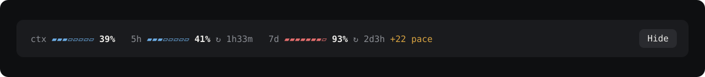

Your Claude Code usage, live above the prompt. When a limit gets close, usage-band holds the agent, waits for the reset, and picks the task back up.



## What it does

- **Live meters** for the context window and the 5-hour and 7-day limits, with the time left to each reset.
- **Pauses before the limit** (95% by default). Tool calls are held and Claude says where it stopped, instead of being cut off mid-task.
- **Continues after the reset.** For the 5-hour window it waits for the reset, keeps the Mac awake meanwhile, then asks Claude to carry on. The 7-day window can be days away, so it waits for you.
- **Forecasts the limit.** `95% in 38m` appears when your current pace reaches the pause line before the window resets, and `+22 pace` when the week is running ahead of an even spend.

## Install

```
/plugin install usage-band --marketplace Achiratch/usage-band
```

Needs Claude Code 2.1.275 or later. The 5-hour and 7-day meters show on Pro and Max plans after the first reply of a session.

## Commands

| Command | |
| --- | --- |
| `/usage-band` | Show or hide the band |
| `/usage-band status` | Meters, forecast, threshold and look, as text |
| `/usage-band pause-at <1-100>` | Set the pause threshold |
| `/usage-band resume` | Lift a pause and ask Claude to continue |
| `/usage-band cancel` | Lift a pause without sending anything |
| `/usage-band theme mono\|classic` | One accent colour, or green, amber and red |
| `/usage-band accent <#rrggbb\|default>` | The accent colour for `mono` |
| `/usage-band compact` | Percentages only, on one short line |

Settings hold across sessions.

## Good to know

- The automatic continue needs the Claude app open and the Mac awake. `caffeinate` stops idle sleep, but closing the lid still sleeps.
- Each session decides on its own, even though sessions share one quota.
- The figures come from Claude Code itself. Nothing leaves your machine.
