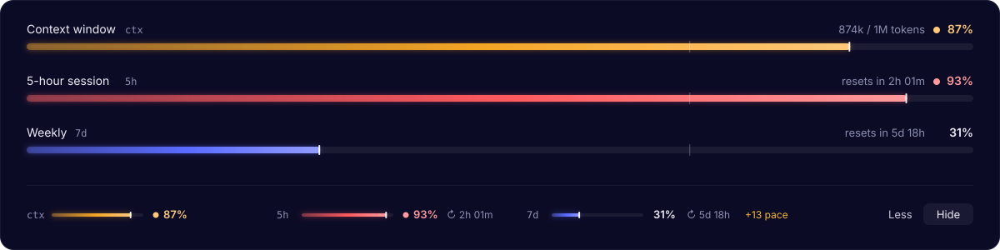

Your Claude Code usage, live above the prompt. When a limit gets close, usage-band holds the agent, waits for the reset, and picks the task back up.



## What it does

- **Live meters** for the context window and the 5-hour and 7-day limits, with the time left to each reset.
- **Warns in three steps.** Each meter is calm in your accent colour, turns amber from 70% and coral from 90% (or 5 points under your pause line, if that is lower). Amber and coral also add a dot and colour the number, so colour is never the only cue, and coral softly breathes.
- **Details on demand.** **Details** opens a panel above the band with each meter's full name, tokens used of the context window, the reset times and a tick at 70%.
- **Pauses before the limit** (95% by default). Tool calls are held and Claude says where it stopped, instead of being cut off mid-task. The pause gets its own line with a **Resume** button.
- **Continues after the reset.** For the 5-hour window it waits for the reset, keeps the Mac awake meanwhile, then asks Claude to carry on. The 7-day window can be days away, so it waits for you.
- **Forecasts the limit.** `95% in 38m` appears when your current pace reaches the pause line before the window resets, and `+22 pace` when the week is running ahead of an even spend.

In the desktop and mobile apps each meter is a thin glowing track whose fill glides from the last reading to the new one. The terminal draws the same meters as `▰▱` bars in the same three colours. Motion stops when the system asks for reduced motion. On a narrow window the tracks drop out and the numbers stay.

## Install

```
/plugin install usage-band --marketplace Achiratch/usage-band
```

Needs Claude Code 2.1.275 or later. The 5-hour and 7-day meters show on Pro and Max plans after the first reply of a session.

**Claude desktop app:** if you have also saved usage-band to your Claude account as a plugin, the app runs that saved copy instead of the one installed above. To update it, save the new `usage-band.plugin` over it (Save plugin, then Replace) and quit and reopen the app.

## Commands

| Command | |
| --- | --- |
| `/usage-band` | Show or hide the band |
| `/usage-band status` | Meters, forecast, threshold and look, as text |
| `/usage-band pause-at <1-100>` | Set the pause threshold |
| `/usage-band resume` | Lift a pause and ask Claude to continue |
| `/usage-band cancel` | Lift a pause without sending anything |
| `/usage-band theme mono\|classic` | `mono`: your accent with amber and coral steps; `classic`: green, amber and red |
| `/usage-band accent <#rrggbb\|default>` | The calm colour for `mono` (default `#5b6cff`) |
| `/usage-band compact` | Percentages only, on one short line |

Settings hold across sessions.

## Good to know

- While the band is hidden, the same figures show as one line in the status bar; with the band on screen that line is left out, so the numbers are not shown twice.
- The automatic continue needs the Claude app open and the Mac awake. `caffeinate` stops idle sleep, but closing the lid still sleeps.
- Each session decides on its own, even though sessions share one quota.
- The figures come from Claude Code itself. Nothing leaves your machine.
